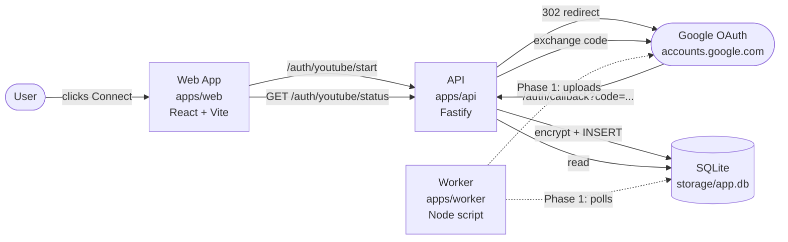
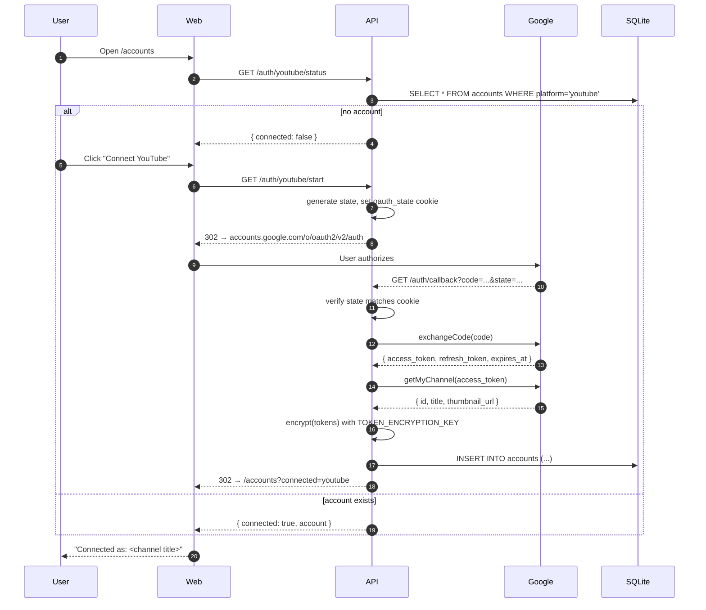
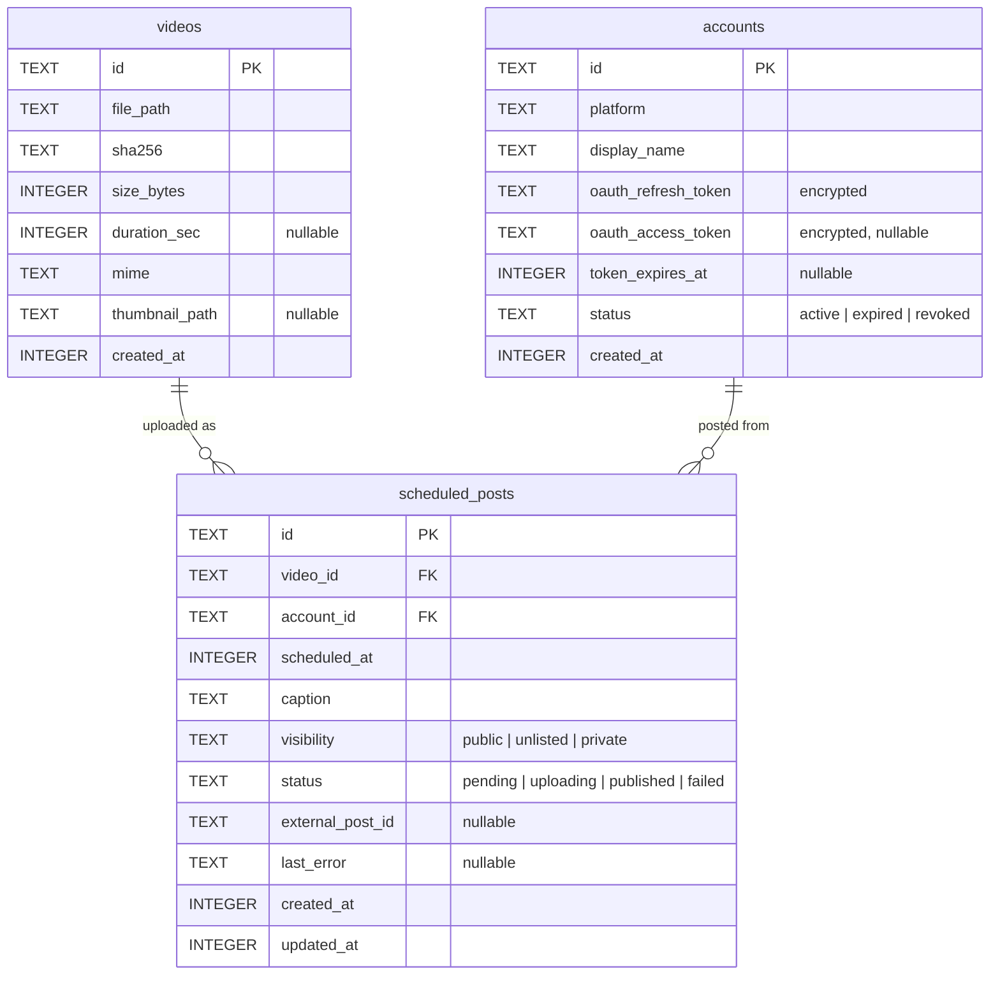

# Architecture

System overview for `social-auto`. This page is the conceptual map — for the *why*, see [decisions](./decisions/); for the *how* of a specific feature, see [features](./features/).

## Bird's-eye view

Three runnable units plus a shared library:

| Unit | Path | Phase 0 role |
|---|---|---|
| Web | `apps/web` | UI shell with one functional page (`/accounts`). Upload/Schedule are placeholders. |
| API | `apps/api` | Fastify server. Hosts OAuth routes, persists tokens, exposes account status. |
| Worker | `apps/worker` | Skeleton only — `console.log` then exit. Will poll `scheduled_posts` and upload in Phase 1. |
| Shared | `packages/shared` | Types, DB schema (SQL DDL), AES-256-GCM token crypto. Source-of-truth consumed by all apps. |

## Data flow — YouTube OAuth (Phase 0)

The only end-to-end flow shipped today. Steps are also documented as a feature in [`features/youtube-oauth.md`](./features/youtube-oauth.md).

### Key invariants

- **`state` cookie vs query param must match.** The state in the `oauth_state` cookie (set at `/auth/youtube/start`) must equal the `state` query param Google forwards to `/auth/callback`. Mismatch → 400. This is CSRF protection.
- **`refresh_token` is the long-lived credential.** `access_token` expires in ~1 hour and is cached encrypted for fast `/status` checks. `refresh_token` is the durable secret — without it, the user must re-authorize from scratch (Google only returns it on first consent).
- **Tokens are encrypted at rest with AES-256-GCM.** Key from `TOKEN_ENCRYPTION_KEY` env var. Format: `iv:tag:ciphertext` (hex). See [ADR-0003](./decisions/0003-aes-256-gcm-token-encryption.md).
- **One YouTube account per install.** Phase 0 upserts by `platform` — re-connecting replaces the access token but keeps the existing refresh token. Phase 2 will allow multiple accounts per platform.
- **Mock client for tests.** When `USE_MOCK_GOOGLE=true`, the API swaps the real `googleapis` client for an in-memory mock with the same interface. Tests never hit Google. See [ADR-0002](./decisions/0002-mock-google-client-pattern.md).

## Module map

### `packages/shared`

Single source of truth for types and schema. Importable as `@social-auto/shared`. No runtime dependencies beyond Node built-ins.

| File | Exports | Purpose |
|---|---|---|
| `types/platform.ts` | `PLATFORMS`, `Platform`, `isPlatform` | The 4 supported platforms as a const tuple. |
| `types/account.ts` | `AccountStatus`, `Account` | Account shape (ISO timestamps, encrypted token fields). |
| `db/schema.ts` | `AccountRow`, `VideoRow`, `ScheduledPostRow`, `SCHEMA_SQL` | TS row types + the SQL DDL string the API runs at startup. |
| `utils/crypto.ts` | `encrypt`, `decrypt` | AES-256-GCM with random IV per call. |

### `apps/api`

Fastify server. Currently exposes four routes; only three are OAuth-related:

| Route | Method | Auth | Purpose |
|---|---|---|---|
| `/health` | GET | none | Smoke check. |
| `/auth/youtube/start` | GET | none | Generate state, set cookie, redirect to Google. |
| `/auth/callback` | GET | state cookie | Exchange code, persist account, redirect to web. |
| `/auth/youtube/status` | GET | none | Decrypt access token, hit Google, return channel info. |

Cross-cutting:

- **`db.ts`** — `openDB(path)` wraps `sql.js`. `:memory:` for tests, file path for dev. Every write call (`run`/`exec`) auto-persists to disk.
- **`google/factory.ts`** — picks `realClient` or `mockClient` based on `USE_MOCK_GOOGLE`.
- **`repositories/accounts.ts`** — thin SQL wrapper around the `accounts` table. Maps sql.js row arrays to typed objects.

### `apps/web`

React + Vite + Tailwind SPA. Three pages today, one with real logic.

| Path | Component | Status |
|---|---|---|
| `/`, `/upload` | `UploadPage` | Placeholder. |
| `/schedule` | `SchedulePage` | Placeholder. |
| `/accounts` | `AccountsPage` | Real — fetches `/auth/youtube/status`, renders Connect button + connected account. |

Dev server proxies `/api` and `/auth` to `localhost:3000`, so the web app talks to the API directly with cookies (CORS configured for `WEB_ORIGIN`).

### `apps/worker`

Phase 0 skeleton. Phase 1 will add a polling loop that reads `scheduled_posts WHERE status='pending' AND scheduled_at <= now()`, calls the Google OAuth client to upload, and updates row state.

## Persistence

SQLite file at `./storage/app.db` (configurable via `DATABASE_URL`). Schema is the union of three tables; Phase 0 only creates `accounts`:

Indexes:

- `idx_scheduled_posts_status_time` on `scheduled_posts(status, scheduled_at)` — accelerates the worker's "what's due now?" query.

## What changes in Phase 1

- New API routes: video upload (multipart), `POST /schedule`, `GET /schedule`.
- New web pages with real logic: `UploadPage`, `SchedulePage`.
- `worker` becomes a real poller.
- `accounts` table gains sibling rows: real `videos`, `scheduled_posts`.
- `google/client.ts` interface grows: add `uploadVideo` (resumable) to both real and mock implementations.

## What changes in Phase 2

- Mock + real OAuth clients for TikTok, Instagram, Facebook (each is a separate client in `apps/api/src/<platform>/`).
- `accounts.platform` becomes multi-row per platform (Phase 0's "single YouTube account" constraint is lifted).
- Web UI gets a platform switcher and per-account selection when scheduling.

## What changed in Phase 3

Phase 3 turns the MVP into a tool that can run unattended on a personal server.

- **Retry with exponential backoff.** `scheduled_posts` gained `retry_count`,
  `next_retry_at`, and `is_dead` columns (migration `0002-phase-1-quota-fk-and-indexes`).
  `ScheduledPostsRepo.scheduleRetry` writes `next_retry_at = now + 2^n minutes`
  (n = retry count, max 5) and on the 6th failure marks the post `dead`. The
  worker classifies errors via `isRetryable` (network / 5xx / timeout / quota)
  and calls `scheduleRetry`; authorization errors (`invalid_grant` / `revoked`)
  mark the account `expired` and the post `dead` immediately. `claimDuePosts`
  filters on `(next_retry_at IS NULL OR next_retry_at <= now)` so retries fire
  at the right moment without blocking fresh posts.

- **Per-platform quota tracking.** The `quotas` table holds
  `(platform, date, used, daily_limit, reset_at)`. `QuotasRepo` exposes
  `get`, `hasRemaining`, and `incrementUsage`; the worker increments on every
  successful publish and refuses new claims when `remaining < UNITS_PER_UPLOAD`.
  The Dashboard queries `GET /quota` and renders a
  "YouTube: 4500 / 10000 units today" bar with warn / danger tones as the
  budget tightens.

- **Health check.** `GET /health` now returns
  `{ worker: { status, last_publish_at, by_status }, accounts: AccountHealth[] }`
  in addition to the original `{ status, uptime_sec, timestamp, storage_dir }` —
  the original fields stay intact so existing monitors keep working.

- **Parallel worker batch.** `processOne` is now dispatched via a
  `runWithConcurrency` helper (cap = 3) inside `pollOnce`, so a single
  YouTube upload, a TikTok upload, and an Instagram upload can run in the
  same poll cycle. Error classification and DB writes still happen per-post,
  so a failure in one slot never blocks the others.

- **List projections.** Both `accounts.list` and `scheduled_posts.list` now
  have a `*Slim` variant that skips encrypted OAuth blobs (accounts) and the
  caption / last_error columns (posts). The slim path is wired into
  `/accounts`, `/schedule`, `/history`, and `/health`; full rows remain
  available via `findById` for the detail / edit view.

- **Preview before schedule.** The Upload page renders a `<Modal>` preview
  showing the per-platform title + description transform before the user
  confirms.

- **History + CSV.** `/history` filters by platform / status / account / date
  range; `/history/export.csv` streams the full row set with the same filters
  applied.

- **Auto-start.** `ecosystem.config.cjs` declares api + worker + web as PM2
  apps with `autorestart: true`, a 512MB memory cap, and merged logs to
  `core/<app>/logs/`. Run `pm2 start ecosystem.config.cjs && pm2 save &&
  pm2 startup` once to enable Windows boot-start.

## See also

- [`features/youtube-oauth.md`](./features/youtube-oauth.md) — full walkthrough of the OAuth feature.
- [`decisions/`](./decisions/) — ADRs for each architectural choice.
